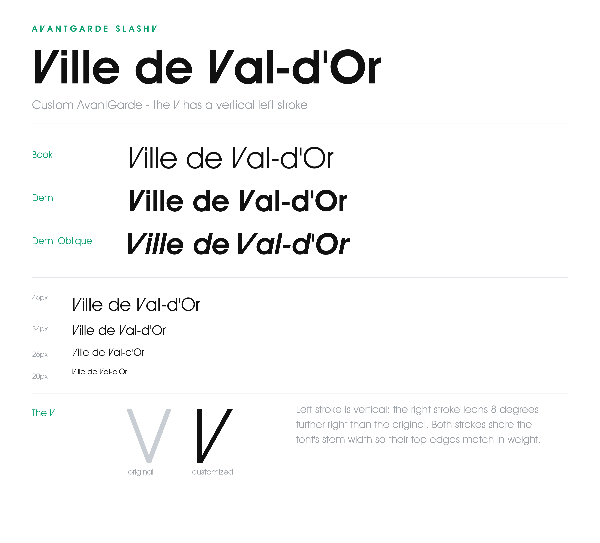
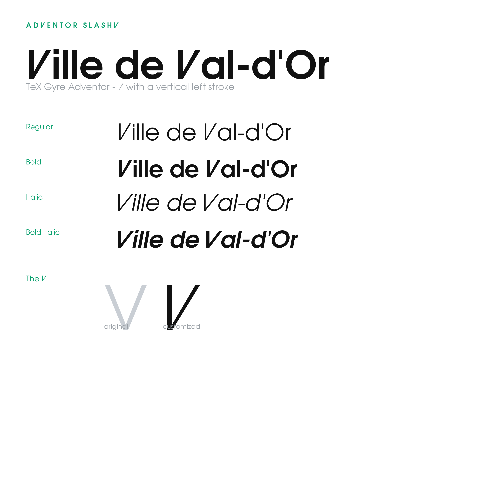

<!-- lang -->[Français](README.md) | **English**

A Python tool that modifies the **V** to follow the logotype of the
City of Val-d'Or: a **vertical** left stroke joined to a diagonal
slanting to the right.

Two source families are supported:

| Source | Generated family | Source license |
| ------ | ---------------- | -------------- |
| **AvantGarde Bk BT** | AvantGarde SlashV | proprietary (Bitstream / Monotype) |
| **TeX Gyre Adventor** | Adventor SlashV | GUST Font License (LPPL) |

| AvantGarde SlashV | Adventor SlashV |
| ----------------- | --------------- |
|  |  |

## What it does

In the original fonts, both arms of the **V** are diagonal. This tool
rewrites the `V` glyph as follows:

- the **left stroke is vertical** (weight modeled on the font's `I`)
- the **right stroke keeps its rising angle**, slightly accentuated toward the right
- both strokes have the same width at the top and join into a single V

| Family | Source file | Style | Output |
| ------ | ----------- | ----- | ------ |
| AvantGarde SlashV | `AVGARDN.TTF` | Book | `fonts/output/AvantGardeSlashV-Book.ttf` |
| AvantGarde SlashV | `AVGARDD.TTF` | Demi | `fonts/output/AvantGardeSlashV-Demi.ttf` |
| AvantGarde SlashV | `AVGARDDO.TTF` | Demi Oblique | `fonts/output/AvantGardeSlashV-DemiOblique.ttf` |
| Adventor SlashV | `texgyreadventor-regular.otf` | Regular | `fonts/output/AdventorSlashV-Regular.ttf` |
| Adventor SlashV | `texgyreadventor-bold.otf` | Bold | `fonts/output/AdventorSlashV-Bold.ttf` |
| Adventor SlashV | `texgyreadventor-italic.otf` | Italic | `fonts/output/AdventorSlashV-Italic.ttf` |
| Adventor SlashV | `texgyreadventor-bolditalic.otf` | Bold Italic | `fonts/output/AdventorSlashV-BoldItalic.ttf` |

The Adventor OTFs (CFF) are automatically converted to TrueType before
modification.

## Requirements

- Python 3.10+
- [fontTools](https://github.com/fonttools/fonttools) and [Pillow](https://python-pillow.org)

```bash
pip install -r requirements.txt
```

**AvantGarde** (proprietary): place your licensed files in
`fonts/input/avantgarde/`. Otherwise, the script looks in the Windows
user fonts.

**Adventor**: already provided in `fonts/input/tex-gyre-adventor/` (GUST license).

## Usage

Double-click **`run.bat`** at the root: it generates the fonts, installs them
for the current Windows user, then regenerates the previews in `images/`.

From the command line:

```bash
python scripts/make_font.py              # les deux familles
python scripts/make_font.py avantgarde   # AvantGarde seulement
python scripts/make_font.py adventor     # Adventor seulement
```

### Installation on Windows

```powershell
powershell -ExecutionPolicy Bypass -File scripts/install_fonts.ps1
powershell -ExecutionPolicy Bypass -File scripts/install_fonts.ps1 -Family Adventor
```

## Project structure

```
fonts/input/avantgarde/           AvantGarde d'origine (*.ttf gitignorés)
fonts/input/tex-gyre-adventor/    TeX Gyre Adventor + licence GUST
fonts/output/                     TTF générés
scripts/                          Générateur, installateur, aperçus
images/                           PNG pour le README
```

## AvantGarde Bk BT

**AvantGarde Bk BT** is the Bitstream version of ITC Avant Garde Gothic Book,
a geometric sans-serif by Herb Lubalin. It is a **proprietary commercial**
font, copyright Bitstream Inc. / Monotype. Commercial use is permitted only
with a purchased license (MyFonts, Fonts.com).

⚠️ Sites offering a "free download" are **not legitimate**.

## TeX Gyre Adventor

**TeX Gyre Adventor** is a free revival (GUST e-foundry) of the
URW Gothic / Avant Garde family. Distributed under the **GUST Font License** (LPPL).
Derivative works must be renamed, hence **Adventor SlashV**.

## License

- **Code** (scripts): MIT.
- **AvantGarde SlashV**: derivative work of a proprietary font, internal
  use only, **do not redistribute**.
- **Adventor SlashV**: derived under GUST/LPPL, redistributable as long as the name
  remains distinct from TeX Gyre Adventor (already the case).

## Disclaimer

This project was created with the help of **Cursor Pro+**.
